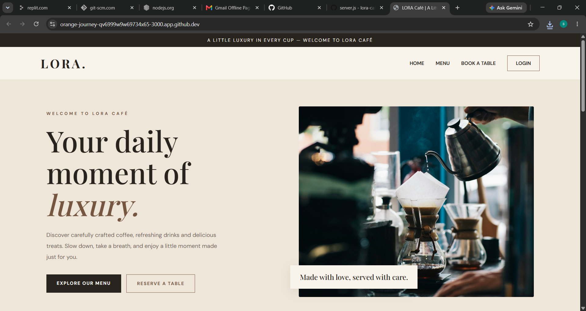
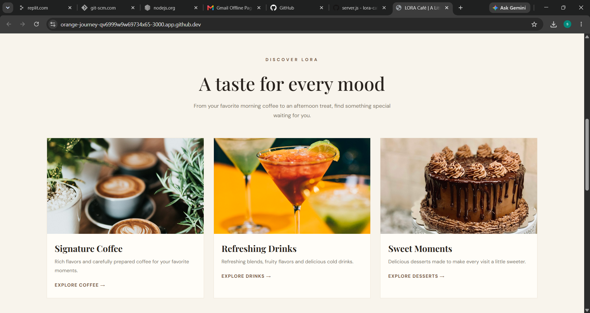

# ☕ LORA Café

### A Modern Café Management & Online Ordering System

LORA Café is a full-stack web application designed to provide a smooth online café experience. Customers can explore the menu, manage their carts, place orders, earn loyalty points, and interact with products, while administrators can manage orders and monitor business activity.

---

## 🌟 Features

### Customer Features
- Browse café products and categories.
- Search and filter menu items.
- Add products to favorites.
- Shopping cart management.
- Online checkout.
- Delivery and pickup options.
- Coupon and discount support.
- Loyalty points and rewards.
- Order history and tracking.
- Product ratings and reviews.
- Customer profile management.
- Notifications and order updates.

### Admin Dashboard
- Dashboard with business statistics.
- Order management and status updates.
- Booking management.
- Sales reports and analytics.
- Best-selling products reports.
- Coupon management.
- Review management interface.

### Design & User Experience
- Modern café-inspired design.
- Responsive layout for mobile, tablet, and desktop.
- Easy navigation.
- Interactive user interface.

---

## 🛠️ Technologies Used

- HTML5
- CSS3
- JavaScript
- Node.js
- Express.js
- SQLite
- SQL
- Git & GitHub

---

## 📸 Screenshots

### Home Page




### Discover LORA



---

## 🚀 Project Links

**GitHub Repository:**  
https://github.com/sal0mmyy7708-dev/lora-cafe

**Live Demo:** Not deployed yet.

---

## ⚙️ Installation

To run the project locally:

1. Clone the repository:

```bash
git clone https://github.com/sal0mmyy7708-dev/lora-cafe.git
```

2. Navigate to the project directory:

```bash
cd lora-cafe
```

3. Install dependencies:

```bash
npm install
```

4. Configure your environment variables in a `.env` file according to the server configuration.

5. Start the application:

```bash
node server.js
```

6. Open your browser:

```text
http://localhost:3000
```

---

## 🔐 Security

- Password hashing.
- Session-based authentication.
- Protected administrative routes.
- Environment variables for sensitive configuration.
- Database access controls.

---

## 👩‍💻 Developer

**Salma Yasser**

GitHub: [@sal0mmyy7708-dev](https://github.com/sal0mmyy7708-dev)

---

## 📄 License

This project is available for educational and portfolio purposes. Please contact the developer before redistributing or reusing the project commercially.

---

### Made with ☕ and passion for technology.
